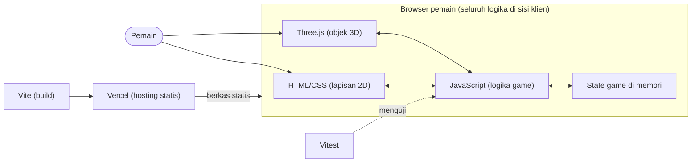
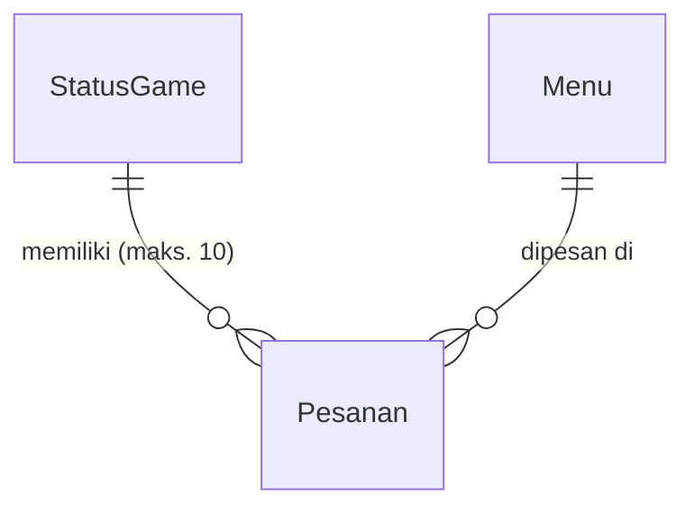

# Architecture: Restoran Simple

## Overview

Restoran Simple adalah aplikasi web statis yang seluruh logikanya berjalan di browser pemain, tanpa backend, database, maupun login. Objek 3D (alat dan bahan) digambar dengan Three.js, sedangkan pelanggan 2D gaya visual novel, dialog, timer, uang, dan panel petunjuk dibuat dengan HTML/CSS di atas kanvas 3D. Logika game (resep, urutan langkah, penilaian, timer, aturan menang/kalah) ditulis dalam JavaScript murni yang dipisah dari tampilan sehingga dapat diuji dengan Vitest. Kode dibangun dengan Vite menjadi berkas statis, lalu dihosting di Vercel.

## Tech Stack

| Lapisan | Pilihan | Alasan | Alternatif yang ditolak |
|---|---|---|---|
| Frontend/UI | Three.js (objek 3D), HTML/CSS (lapisan 2D), JavaScript, Vite. Versi: latest stable (verifikasi: `npm view three version`, `npm view vite version`) | karena ketentuan tugas dan sekalian ingin belajar (pilihan mahasiswa) | - |
| Backend | Tidak ada (game berjalan sepenuhnya di browser) | Tidak ada login, penyimpanan progres, maupun data yang perlu diproses di server (pilihan mahasiswa; karena ketentuan tugas dan sekalian ingin belajar) | - |
| Database | Tidak ada (state game di memori; progres tidak disimpan) | Tiap sesi mulai dari nol sesuai non-goals di PRD (pilihan mahasiswa) | - |
| Auth | Tidak ada | Game tanpa akun dan tanpa data pribadi (pilihan mahasiswa) | - |
| Hosting | Vercel (hosting statis) | Hasil build Vite berupa berkas statis yang cukup dihosting di Vercel (pilihan mahasiswa) | - |
| Testing | Vitest. Versi: latest stable (verifikasi: `npm view vitest version`) | Logika game dijaga tes otomatis sesuai kendali risiko R1 (pilihan mahasiswa) | - |

Tidak ada layanan tambahan (`stack.extra` kosong).

## System Diagram



## Project Structure

Struktur dasar mengikuti hasil perintah scaffold resmi Vite (`npm create vite@latest`, template vanilla JavaScript); bentuk persisnya dipastikan di task setup (T-001). Subfolder di dalam `src/` di bawah ini adalah usulan asisten.

```text
restoran-simple/
├── AGENTS.md              # Instruksi untuk agen AI (root)
├── README.md              # Gambaran proyek dan cara menjalankan (root)
├── CLAUDE.md              # Berisi @AGENTS.md (penunjuk untuk Claude Code)
├── GEMINI.md              # Berisi @AGENTS.md (penunjuk untuk Gemini CLI)
├── index.html             # Titik masuk Vite; memuat kanvas 3D dan kerangka UI 2D
├── package.json           # Skrip: dev, lint, test, build
├── vite.config.js         # Konfigurasi Vite dan Vitest
├── .env.example           # Contoh variabel lingkungan (saat ini tidak ada yang wajib)
├── .github/               # Workflow CI, Dependabot, template PR
├── docs/                  # PRD, arsitektur, tugas, keputusan, dan dokumen proyek lain
├── public/                # Berkas statis (mis. aset yang disalin apa adanya)
├── src/
│   ├── main.js            # Merangkai logika, scene 3D, dan UI
│   ├── game/              # Logika murni (tanpa DOM/Three.js): menu, resep, penilaian, timer, state
│   ├── scene/             # Three.js: kamera, objek alat dan bahan, interaksi pointer
│   ├── ui/                # HTML/CSS: halaman awal, HUD, dialog pelanggan, panel petunjuk, layar hasil
│   └── styles/            # CSS dengan token desain (lihat DESIGN_SYSTEM.md)
└── tests/                 # Tes Vitest untuk src/game/
```

## Data Model

Seluruh data hidup di memori selama sesi; tidak ada tabel database. Tidak ada field yang berisi data pribadi (`personal_data`: none).

**Menu** (data tetap, dimuat dari `menu_catalog` di SPEC)

| Field | Tipe | Keterangan |
|---|---|---|
| id | string | Pengenal menu, M01 sampai M10 |
| name | string | Nama menu |
| category | enum | `makanan` atau `minuman` |
| price_idr | number | Harga dalam rupiah; tiap menu berbeda |
| steps | array | Urutan langkah resep: bahan (`ingredient`) atau proses (`process`) beserta alat dan durasi 3 detik |

**Pesanan**

| Field | Tipe | Keterangan |
|---|---|---|
| customer_number | number | Nomor pelanggan 1 sampai 10 |
| menu_id | string | Menu yang dipesan (merujuk Menu.id) |
| status | enum | `menunggu`, `terlayani`, atau `pergi` |
| time_left_seconds | number | Sisa waktu dari 30 detik |
| dish | array | Urutan bahan dan proses yang sudah dipakai pemain; dibandingkan dengan `steps` saat Sajikan |

**StatusGame**

| Field | Tipe | Keterangan |
|---|---|---|
| screen | enum | `awal`, `main`, atau `hasil` |
| customer_number | number | Pelanggan yang sedang dilayani |
| total_money_idr | number | Total uang yang terkumpul |
| paused | boolean | Benar bila game sedang di-Pause |
| result | enum | `menang` atau `kalah` (terisi di layar hasil) |

Relasi: satu StatusGame berisi sampai 10 Pesanan secara berurutan, dan tiap Pesanan merujuk tepat satu Menu.



**Data awal Menu** (harga dan urutan langkah; setiap proses berdurasi 3 detik)

| ID | Menu | Kategori | Harga | Urutan langkah |
|---|---|---|---|---|
| M01 | Telur Goreng | makanan | Rp7.000 | telur → garam → goreng (kompor + penggorengan) |
| M02 | Roti Panggang | makanan | Rp9.000 | roti → panggang (kompor + penggorengan) |
| M03 | Tumis Sayur | makanan | Rp11.000 | sayur → garam → goreng (kompor + penggorengan) → aduk (spatula) |
| M04 | Omelet Sayur | makanan | Rp14.000 | telur → sayur → garam → goreng (kompor + penggorengan) → balik (spatula) |
| M05 | Roti Goreng Telur | makanan | Rp17.000 | roti → telur → susu → gula → goreng (kompor + penggorengan) → balik (spatula) |
| M06 | Kopi Hitam | minuman | Rp8.000 | biji kopi → air → seduh (alat pembuat kopi) |
| M07 | Jus Buah | minuman | Rp10.000 | buah → air → blender (blender buah) |
| M08 | Kopi Susu | minuman | Rp12.000 | biji kopi → air → susu → gula → seduh (alat pembuat kopi) |
| M09 | Es Kopi Susu | minuman | Rp15.000 | biji kopi → air → seduh (alat pembuat kopi) → es batu → susu |
| M10 | Smoothie Buah Susu | minuman | Rp18.000 | buah → susu → es batu → blender (blender buah) |

Menu, harga, dan urutan ini adalah usulan asisten yang disetujui mahasiswa. Total waktu proses terpanjang adalah 6 detik, di bawah batas 20 detik.

## Data Flow

1. **Memulai dan menerima pesanan (F1, F2, F4):** pemain menekan Start; `StatusGame.screen` menjadi `main`, pelanggan berikutnya dipilih dengan menu acak dari 10 menu, dialognya tampil, lalu timer 30 detik berjalan. Validasi: Start hanya berlaku di layar `awal`.
2. **Menyusun hidangan (F3, F5):** pemain memilih bahan atau alat 3D; scene meneruskan pilihan ke logika game, yang menambahkan bahan atau proses ke `Pesanan.dish`. Proses berjalan 3 detik dengan indikator progres. Validasi: input hanya diterima bila `paused` salah dan pesanan berstatus `menunggu`. Panel petunjuk (F5) membaca `Menu.steps` dan tidak mengubah state.
3. **Menilai dan membayar (F2, F4):** saat Sajikan ditekan, `dish` dibandingkan dengan `Menu.steps` (bahan, proses, dan urutan). Bila sama, `total_money_idr` bertambah sebesar `price_idr` dan pelanggan berikutnya muncul; bila berbeda atau timer mencapai 0, status menjadi `pergi` dan layar hasil kalah tampil. Setelah pelanggan ke-10 terlayani, layar hasil menang tampil.

Validasi input terjadi di logika game sisi klien. Otorisasi tidak berlaku karena tidak ada login dan hanya satu peran (pemain).

## External Services

| Layanan | Fungsi | Data yang dikirim | Batas/biaya gratis | Rencana cadangan |
|---|---|---|---|---|
| Vercel | Hosting statis hasil build Vite | Tidak ada data pengguna; hanya berkas build yang diunggah dari repositori | Cek paket terbaru | Hasil build (`npm run build`) berupa berkas statis sehingga dapat dihosting di layanan statis lain bila Vercel bermasalah |

Font memakai font sistem sehingga tidak ada layanan font eksternal.

## Environments and Configuration

| Lingkungan | Perbedaan |
|---|---|
| Lokal | `npm run dev` menjalankan server pengembangan Vite di komputer pengembang. |
| Staging/preview | Build dari branch atau pull request untuk dicoba sebelum digabung; dipastikan dengan pengaturan Vercel pada T-001 atau saat deployment pertama. |
| Produksi | Build dari branch `main` yang dipublikasikan di Vercel. |

Saat ini tidak ada variabel lingkungan yang dibutuhkan, sehingga tidak ada nilai rahasia. Jika kelak ada, berkas `.env` tidak di-commit dan `.env.example` (hanya nama variabel tanpa nilai) selalu disediakan.

## Deployment

1. Perubahan dikerjakan di branch terpisah dan dibuka sebagai pull request.
2. GitHub Actions menjalankan `npm install`, `npm run lint`, `npm test`, dan `npm run build`; pull request hanya boleh digabung bila semuanya lulus.
3. Setelah merge ke `main`, Vercel membangun proyek dengan `npm run build` dan mempublikasikan hasilnya. Pengaturan Vercel (preset Vite, direktori keluaran bawaan Vite) diperiksa pada deployment pertama.
4. Pemeriksaan kesehatan: buka URL produksi, pastikan halaman awal tampil, lalu mainkan satu putaran penuh (Start → pesanan → bayar atau pergi) sesuai R3.
5. Rollback: kembalikan ke deployment sebelumnya lewat dasbor Vercel (cek fitur rollback pada paket yang dipakai), atau revert commit di `main`.

## Platform Notes

1. Rendering: situs statis; seluruh logika berjalan di browser, tanpa server-side rendering (`rendering`: static).
2. SEO tidak diperlukan (`seo`: false) dan hanya Bahasa Indonesia yang didukung (`i18n`: false).
3. Pisahkan logika dari tampilan: folder `src/game/` tidak boleh mengimpor Three.js atau DOM agar bisa diuji dengan Vitest (R1).
4. Gunakan satu jam permainan (game clock) yang menjadi sumber waktu untuk timer 30 detik dan proses 3 detik; saat Pause jam ini berhenti sehingga keduanya ikut berhenti.
5. Bila timer mencapai 0 di tengah proses, proses dibatalkan dan pelanggan langsung pergi.
6. Pasang penanganan error global agar error saat game berjalan menampilkan pesan "Terjadi kesalahan" dengan tombol kembali ke halaman awal (R2).
7. Aset 3D dijaga kecil; bentuk geometri dasar Three.js dipakai lebih dulu bila model siap pakai belum ada.
8. Lapisan 2D (HTML/CSS) berada di atas kanvas 3D; panel petunjuk selalu tampil di halaman yang sama dengan game (F5).
9. Tidak ada penyimpanan di browser; tiap muat ulang halaman memulai game dari nol.

## Constraints and Trade-offs

- Waktu hanya 1 minggu dan tim 1 orang, sehingga lingkup dibatasi pada 5 fitur *must* dan 10 menu; prioritas fitur dirujuk ke `docs/PRD.md`.
- Platform web dipilih agar dimainkan lewat browser tanpa instalasi (ADR-001).
- Three.js, HTML/CSS, JavaScript, dan Vite dipilih karena ketentuan tugas dan keinginan belajar; trade-off-nya, seluruh grafis 3D dan interaksi harus dibangun sendiri (ADR-002).
- Tanpa backend dan database, progres tidak bisa disimpan dan skor online tidak tersedia, tetapi tidak ada server yang perlu dipelihara (ADR-003).
- Tanpa login dan tanpa data pribadi, risiko privasi sangat kecil, tetapi tidak ada identitas pemain (ADR-004).
- Vercel dipakai untuk hosting statis dengan batas paket gratis yang perlu dicek (ADR-005).
- Pengujian memakai Vitest untuk logika game, sedangkan tampilan 3D dicek manual (R3); level proses dasar dipilih untuk satu pengembang (ADR-006).
